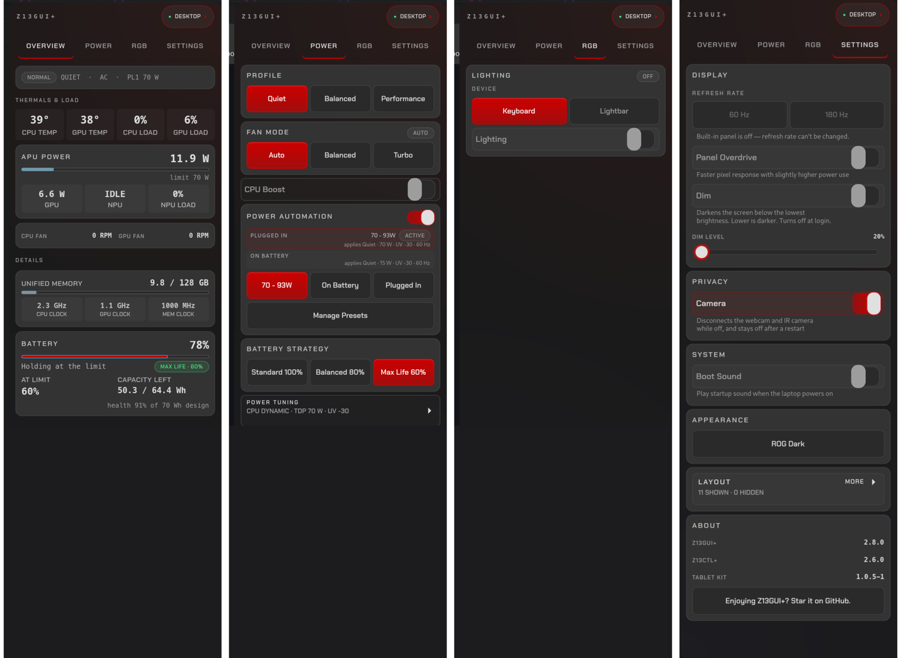

# z13ctl+ — Linux RGB, fan, TDP & undervolt control for the ASUS ROG Flow Z13

<div align="center">

[](https://github.com/aic0d3r/z13ctl-plus/releases)
[](https://aur.archlinux.org/packages/z13ctl-plus-bin)
[](LICENSE)

[Stack](#the-z13-stack) •
[Install](#install) •
[Quick Start](#quick-start) •
[Documentation](#documentation)

</div>

One CLI and systemd user daemon for the **2025 ASUS ROG Flow Z13** (GZ302, AMD Strix Halo):

- **Lighting** — RGB keyboard and lightbar
- **Power** — TDP/PPT limits, Curve Optimizer undervolt, AMD P-State policy, battery limit
- **Cooling** — custom fan curves
- **Automation** — named presets that switch on AC/battery
- **Display** — coordinated KDE posture, rotation, scale, and refresh
- **Telemetry** — CPU, GPU, NPU, fans, battery

Fork of [`dahui/z13ctl`](https://github.com/dahui/z13ctl) that installs alongside
upstream. Other Strix Halo machines are experimental
([details](https://aic0d3r.github.io/z13ctl-plus/ecosystem/)).

## The Z13 stack

| Project | What it does |
|---|---|
| **z13ctl-plus** | This repo: daemon + CLI |
| [**z13-backlight-quirk**](https://github.com/aic0d3r/z13-backlight-quirk) | **Darker minimum screen brightness** via a kernel quirk — `yay -S z13-backlight-quirk-dkms` |
| [z13gui-plus](https://github.com/aic0d3r/z13gui-plus) | Touch overlay drawer for the daemon |
| [z13-tablet-kit](https://github.com/aic0d3r/z13-tablet-kit) | Tablet posture detection, touch scrolling, context menus |

<p align="center">
  
  <br/>
  <em>Z13GUI+ drawer — Overview, Power, RGB, and Settings</em>
</p>

## Install

```sh
# Arch Linux (AUR)
yay -S z13ctl-plus-bin

# Debian / Ubuntu
sudo apt install ./z13ctl-plus_*.deb

# Fedora / RHEL
sudo dnf install ./z13ctl-plus_*.rpm

# Manual (from release tarball)
wget https://github.com/aic0d3r/z13ctl-plus/releases/download/v2.6.0/z13ctl-plus_2.6.0_linux_amd64.tar.gz
tar xzf z13ctl-plus_2.6.0_linux_amd64.tar.gz
sudo install -Dm755 z13ctl-plus /usr/local/bin/z13ctl-plus
sudo z13ctl-plus setup

# After stopping any other Z13 hardware daemon
systemctl --user enable --now z13ctl-plus.socket z13ctl-plus.service
```

See the [Installation guide](https://aic0d3r.github.io/z13ctl-plus/installation/) for
source builds, v1-to-v2 migration, and uninstall. Packages leave the daemon
disabled; enable it only after stopping any other daemon that controls the same hardware.

## Quick Start

```sh
z13ctl-plus preset restore-recommended   # AC + battery presets
z13ctl-plus preset policy --enable --ac "Plugged In" --battery "On Battery"
z13ctl-plus status                       # live telemetry and overrides
```

## Documentation

Full documentation at **<https://aic0d3r.github.io/z13ctl-plus>**

- [Installation](https://aic0d3r.github.io/z13ctl-plus/installation/)
- [Quick Start](https://aic0d3r.github.io/z13ctl-plus/getting-started/)
- [Commands](https://aic0d3r.github.io/z13ctl-plus/commands/)
- [Daemon](https://aic0d3r.github.io/z13ctl-plus/daemon/)
- [API](https://aic0d3r.github.io/z13ctl-plus/api/)
- [Ecosystem & compatibility](https://aic0d3r.github.io/z13ctl-plus/ecosystem/)
- [Contributing](https://aic0d3r.github.io/z13ctl-plus/contributing/)

## Say thanks

If z13ctl-plus makes your Z13 nicer to live with, [star it on GitHub](https://github.com/aic0d3r/z13ctl-plus). If you want to chip in, you can [sponsor me on GitHub](https://github.com/sponsors/aic0d3r).

## License

[Apache 2.0](LICENSE)
